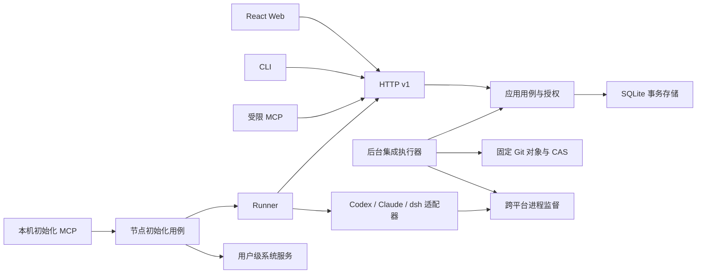

# 实现架构

中心是模块化单体。不同 Agent CLI 的差异只存在于适配器；任务状态、候选权威、预算和恢复不能依赖某个 SDK 会话。

| 包 | 职责 | 禁止的依赖方向 |
|---|---|---|
| domain | 版本化记录与纯输入校验 | 不依赖 SQL、HTTP、Git、SDK |
| store | SQLite 事务、幂等收据、审计/通知 outbox、一致快照 | 不做业务授权 |
| app | 用例、状态变更、预算结算、许可、集成与恢复协调 | 不解析某个 Agent 的事件格式 |
| httpapi / apiclient / mcp | 协议解码、认证传输、入口映射 | 不复制业务状态机 |
| gitops | 对象、bundle、真实差异、候选提交、条件更新 | 不理解任务或数据库 |
| process / filelock | 进程树生命周期、跨进程互斥 | 不理解提示词与任务 |
| localfile | 私密文件权限、原子替换 | 不理解节点或任务 |
| onboarding | 本机节点配对、重入初始化和启动协调 | 不做任务调度或 owner 授权 |
| mcpconfig | 本机客户端发现、MCP 注册配置与冲突检查 | 不配对节点、不启动 Runner、不做任务执行适配 |
| nodeservice | launchd / systemd / Task Scheduler 用户级服务 | 不持有中心业务规则或模型协议 |
| agent | 官方结构化接口、能力差异 | 不做放行决定 |
| runner | 本地许可监督、材料交接、持久重放 | 不更新受保护分支 |
| web | 交互和状态展示 | 不成为授权或验收事实来源 |

应用用例显式编写，不引入通用编排框架。协议记录同时生成 TypeScript 与 JSON Schema。HTTP 严格拒绝未知字段；业务校验仍在应用/领域层。新增传输只调用现有用例，不能独立更新状态。

本机初始化 MCP 是独立入口，只接受中心地址、一次性配对码、公共 CA 路径和节点显示配置；执行文件及数据目录由 MCP 启动配置固定。它不会暴露任意命令执行、owner 批准或发布工具。配对先持久化身份，服务安装失败后可重试初始化，不能覆盖现有节点身份、工作目录或完成消息。后台服务启动状态与中心实际接收心跳分开报告。

## 事务与外部操作

每次授权写操作在同一个 SQLite 事务内执行幂等键检查、状态转移、预算变化、审计与 outbox。单中心串行化写事务；OS 文件锁阻止同一数据目录启动两个服务。SQLite 数据库版本不兼容时拒绝启动。当前 schema v1 使用按 kind/id 分类的类型化 JSON 记录，演进先迁移版本，不能直接改变旧记录语义。

Git、模型与验证子进程不放进数据库事务。执行器读取计划，执行 I/O，再对最新状态重验。固定候选流程为：

1. Runner 在 Run 有效期间交接 B/H 与不可变 bundle。
2. 中心导入并核验 B→H 真实路径，在最新 M 上创建固定双父合并提交 C，检查 M→C。
3. 新 Run/新会话独立评审 C。优先不同可用工具；原工具也必须新会话。
4. 中心在独立目录检出 C，执行已配置检查，检查前后核验固定对象与工作树；所有检查必须通过。
5. 受保护路径还需 owner 对精确 C 特别批准。
6. 同一事务完成最后授权检查并保存 `dispatching` intent；随后使用预期旧 OID M 条件推送 C。
7. 查询实际远端。包含精确 C 才记录成功；仍为 M 可做有限重试；其他主线变化须重新构建、评审和检查。

候选一旦有效接收，开发 Run 的租约不再支配它。旧 Run 的迟到请求不能新建候选、扩大范围或重新扣减。测试记录必须指向固定 C；重新构建后清空旧评审、检查和特别批准。

## 时间与失败

每节点最多两个 Agent Run；首建任务每 Run 最多 3600 秒、累计最多 14400 秒，默认 UI 两轮修复/两次平台重试。允许用户在停止执行后显式批准新的有限额度；已用量不得清零。项目预算为必填有限额度。

领取与验证先预留额度，心跳/完成只结算差额。时间以中心观测及 Runner 上报的较大值为准；失联且无法确认的执行按完整授予额度保守记账。预算不是精确模型费用上限。使用最后一次允许重试后的成功结果仍能继续通过门禁。

初始心跳 10 秒、租约 45 秒、Runner 连续失联 30 秒即停，另受单调本地截止和任务许可截止限制。服务端 Date 与 RTT 用于换算，避免依赖两台电脑绝对时钟一致。取消普通后代进程通过 Unix 进程组或 Windows Job Object；未知进程身份与脱离受管范围的行为不伪装成已停止。

备份基于 SQLite 一致快照固定材料闭包；校验摘要后发布清单。恢复先暂停、撤销旧节点、重建必要 Git 对象，再对账。尚未上传的工作目录不会凭空恢复。

## 扩展方式

- 接新 Agent：增加适配器及结构化协议测试，不改任务状态枚举。
- 接新 MCP 客户端：在 mcpconfig 中增加配置适配，继续启动同一个 bootstrap；这不授予 Runner 调度新 Agent 的能力。
- 新入口：新增 API/MCP 映射，复用 app 用例。
- 新门禁：扩展中心检查政策与固定 C 证据，不能靠前端布尔值放行。
- 新平台：实现 process/filelock 的平台边界并运行真实进程测试。
- 新存储：围绕用例所需事务语义迁移；不让业务调用裸 SQL。

`.github/workflows/ci.yml` 是三系统检查配置，本地创建该文件不代表远端 CI 已实际执行。真实 Agent 验收显式 opt-in，普通测试不隐式消费模型配额。
