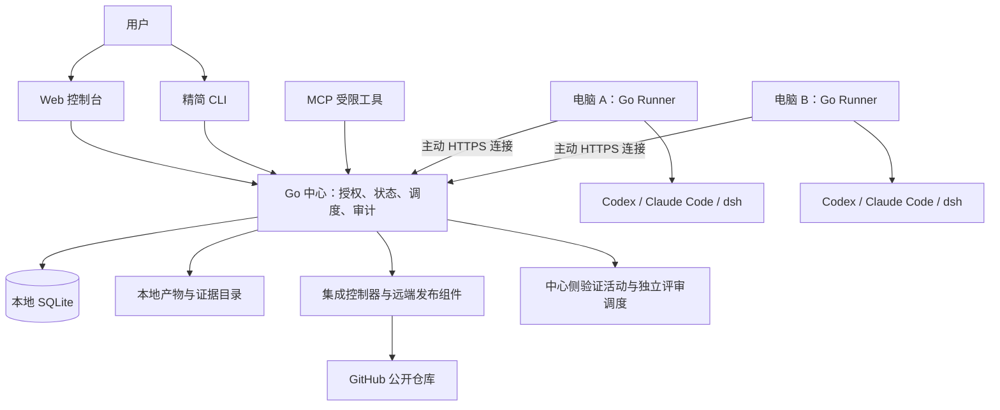

# Coordica：轻量多 Agent 开发协调底座设计基线 v0.2

**状态：用户于 2026-10-11 授权按本基线实施阶段 A，正在开发和验收。**  
**整理日期：2026-10-10。**  
**来源：**[原始 v0.1 的保留副本](./lightweight-multi-agent-design-baseline-v0.1.md) 与 [六轮设计研讨记录](./design-interview.md)。用户提供的原文件未修改。

本文整合用户已确认的产品决定，并补全使其成立所需的状态、授权、集成、恢复和验收规则。研讨记录 R01–R30 是已确认决定；本文的具体状态枚举、模块划分和操作规则是供整体确认的详细设计，不能反向声称用户已经逐项批准。协议字段、数据库表结构和原型阶段才能确定的工具兼容版本尚未冻结。

2026-10-11 用户已明确授权开始阶段 A，以 v0.2 作为开发基线。原始文档保留，后续变化通过新的决定记录说明替代关系。

## 1. 产品目标与阶段边界

Coordica 协调多个编程 Agent 对同一个项目进行开发：Agent 理解、实现、评审和修复，程序维护事实、授权、执行归属、预算、验证与集成。长期目标是在明确的目标授权内自动完成项目开发，人主要介入重大决策和无法自动解决的异常。

首个使用者是一名开发者，在两台电脑上使用多个 Agent；首个试点项目是 Coordica 自身。首版以单项目、单 Git 仓库、单受保护主分支为验收边界；数据与授权保留 project 标识，后续可扩展，但不承诺首版多项目并行。

| 阶段 | 交付范围 | 完成标准 |
|---|---|---|
| A：首版受控协作 | 人工建立需求记录与任务、托管执行、范围申请、独立评审、可信验证、普通候选自动合并、审计、预算、备份与基本恢复 | 两台电脑真实协作，Codex、Claude Code、dsh 都能实际执行并提交；正常及故障路径通过验收 |
| B：目标授权内自动推进 | 按需调用 Requirement/Leader，自动规划、派生任务、按政策批准普通范围扩展、连续修复与推进 | 无需逐任务人工介入，仍遵守目标、权限、预算和门禁 |
| C：交付与维护 | 固定产物发布、生产授权、健康检查、维护反馈、受控自动升级与回退 | 从需求到实际交付可追溯，事故能止损并恢复 |

首版不是自动需求规划、通用 Agent 编排、生产部署或自动升级系统。公网消息中转属于后续可选能力。三阶段共享事实模型，但不能把阶段 B/C 的未来方向计为首版已有功能。

## 2. 已冻结的主要选择

| 主题 | 决定 | 研讨依据 |
|---|---|---|
| 使用场景 | 单人、两台电脑，以自身为试点 | R01–R02 |
| 信任边界 | 检测越界并拒绝集成；允许私人环境中的越界修改已经发生 | R03 |
| 工具 | Codex、Claude Code 从首版协作；dsh 首版提供真实基础执行 | R04、R08 |
| 执行 | Runner 托管启动 CLI，管理进程、事件、取消与交接 | R05 |
| 部署 | 一台电脑运行中心及集成入口；第二台主动连接；不自动换主 | R06 |
| 合并 | 普通候选门禁通过后自动合并固定提交；不要求逐次人工批准 | R07 |
| 任务批准 | 一次批准覆盖同目标、范围、验收、预算内的有限修复和重试 | R09 |
| 受保护变化 | 门禁、权限、集成控制等变更特别人工批准，绑定固定候选 | R10 |
| 范围与资源 | 目录/文件模式白名单；普通范围可重叠；显式热点资源排他 | R11 |
| 离线 | 短时重连，超过宽限后停受管进程并保留目录，恢复时核对 | R12 |
| 自动化方向 | 主服务设置提供后续自动批准；目标授权内允许普通扩围 | R13–R14、R23 |
| Git 托管 | GitHub 公开仓库；只有用户及其授权的中心身份直接写入 | R15 |
| 技术栈 | Go 中心与 Runner、React + TypeScript Web、SQLite | R16 |
| 架构 | 模块化单体；中心提供 React 静态产物；不引入 Redis、独立 MQ 或微服务 | R17 |
| 入口与契约 | API-first，Web + 精简 CLI + MCP；语言无关、版本化、校验并尽量生成类型 | R18、R20 |
| 适配 | 官方程序接口和结构化事件；显式能力矩阵；首期不预设 TS/Python 后台组件 | R19、R21 |
| 异常 | 普通错误先有界修复，达到上限或结果不明才升级 | R24 |
| 评审 | 每个代码候选必须独立 Agent 评审，计入任务预算 | R25 |
| 平台与连接 | macOS、Windows、Linux；首版局域网；公网中转以后可选 | R26–R27 |
| 自举升级 | 合并不等于启用；用户选择已验证版本升级中心和 Runner | R28 |
| 限制 | 每节点 2 个 Agent Run、单 Run 60 分钟、任务累计 4 小时、2 轮修复、2 次瞬态重试；可配置 | R29 |
| Git 历史 | 保留提交关系，生成合并候选 C；首版不强制 GitHub PR | R30 |

v0.1 的 D01–D15 继续成立；任务短分支进一步落实为每个有效执行尝试隔离分支和工作目录，避免旧 Run 污染新执行。

## 3. 最小架构与部署

中心和电脑 A 的 Runner 可同机运行，仍是不同执行职责。验证可复用 Runner 的进程管理实现，不增加一套常驻验证服务；远端发布组件在中心内，是唯一使用平台 GitHub 写凭据的组件。

中心为模块化单体，拟分为项目与需求、任务契约、身份授权、调度租约、预算资源、候选集成、验证证据、审计与 outbox、HTTP/MCP 入口等模块。模块内通过明确接口协作，不用内部 HTTP 模拟微服务。

平台运行依赖是 Go 编译产物、Git 和本地文件系统。React 的开发/构建需要 Node，交付后的静态文件由中心提供。运行 dsh 的节点另需 dsh 要求的 Node；项目自身的语言工具链由项目配置声明，不要求不运行 dsh 的节点安装 Node。

中心与 Runner 均按 macOS、Windows、Linux 发布并实际验证。支持的具体系统版本、架构、工具版本记录在发布能力矩阵中；编译成功不是运行验收。中心数据目录在本机磁盘，不让两台电脑共享活动 SQLite 文件。

## 4. 身份、权限和信任边界

### 4.1 可承诺的控制范围

首版信任用户、其私人设备的系统管理员和中心控制程序；考虑模型出错、进程/网络故障、重复和迟到消息、非预期主线变化。不以恶意设备管理员、同一 OS 用户下全面凭据隔离或被攻陷节点的拜占庭防御为首版保证。

路径授权决定哪些提交能进入主线，不保证任意本地写入都被阻止。工作目录、worktree、提示词、进程组和工具原生 sandbox 均不能单独证明完整隔离。

中心只向 Runner 发放项目及节点范围内的执行凭据，不向 Agent 发放平台 GitHub 写凭据。开发端可读取公开仓库并生成本地提交，随后通过受认证通道提交代码材料。私人设备原有的 SSH agent、credential helper、keychain 或 gh 登录不因此消失；用户以自己的既有身份手工推送也不是平台能彻底禁止的行为。

### 4.2 首版授权矩阵

| 动作 | 授权方式 |
|---|---|
| 人工创建/修改需求与任务、设置验收、预算、初始范围 | 用户 |
| 首次启动任务 | 用户批准版本化任务契约 |
| 原范围内自测、普通修复、评审、冲突适配、有限工具重试 | 同一次任务批准覆盖，由程序检查累计限制 |
| 普通范围扩展 | 首版用户批准新授权版本；阶段 B 可由预设政策自动批准 |
| 改变目标、非目标、验收，增加预算或对外权限 | 新决策/批准，不能作为普通扩围处理 |
| 受保护门禁、权限、集成控制变更 | 用户特别批准最终候选 C，且仍通过当前已批准规则 |
| 普通候选上传及门禁通过后的精确主线更新 | 中心代表用户执行已授权动作 |
| 生产部署、破坏性外部操作 | 不属于首版可执行动作 |
| 启用新的中心/Runner 运行版本 | 首版用户显式选择已验证版本并升级 |

批准绑定动作、项目、任务/契约/授权版本、必要的固定候选和预算，不是永久的“这个 Agent 可以做任何事”。身份取自认证上下文，不能取自模型报文里的 owner/agent_id。

### 4.3 GitHub 公开仓库

用户作为唯一仓库 owner，不给其他人员、App 或 deploy key 非预期写权限。公开读取和 fork 不授予直接推送或合并权限；中心凭据属于用户授权的自动执行身份。分支保护作为附加约束，不替代中心门禁；用户自己仍能修改仓库设置，属于既定信任边界。参见 GitHub [个人仓库权限](https://docs.github.com/en/repositories/managing-your-repositorys-settings-and-features/repository-access-and-collaboration/permission-levels-for-a-personal-account-repository)。

外部 issue/PR 不自动成为获批任务或候选。GitHub 可关闭 PR 或限制为 collaborators；具体设置在仓库初始化时展示并核实，不把公开仓库等同于开放写入。

密钥、节点令牌、原始私密上下文不写入公开仓库、规范文件、普通日志或默认导出。发布凭据与验证进程的配置和环境分开；如需对同一 OS 用户下恶意代码强隔离，另行引入专用用户/沙箱/设备，不把首版环境变量清理描述为完整安全隔离。

## 5. 需求、任务、Run 与候选

### 5.1 双池与追溯

需求池保留原文、来源、版本、确认与决策；任务池承载功能、缺陷、验证和集成修复等已授权工作。需求与任务多对多关联，可区分实现、验证和修复关系。首版支持人工记录与关联，不自动分析/拆分需求。

实现失败留在原任务修复；产品目标或验收变化返回需求/决策流程；机械冲突留在原任务或其关联修复活动。不能把所有工程失败重新包装成新需求以重置限制。

### 5.2 任务契约

任务就绪前至少包含以下语义，字段名在协议设计时冻结：

| 类别 | 必要信息 |
|---|---|
| 身份与依据 | project、task、需求及版本、用户责任人、任务类型 |
| 目标 | 目标、非目标、交付内容、可观察验收、失败条件 |
| 依赖 | 前置任务、接口/规范版本、热点资源 |
| 权限 | 源码路径白名单、受保护路径、运行时目录、允许的外部动作 |
| 执行依据 | 固定代码基线、上下文包、工具配置与能力要求 |
| 限制 | Run、任务和项目预算，修复/重试上限，停止条件 |
| 交接 | 固定提交、证据、检查点、风险、下一步 |

契约、路径授权、有效政策分别版本化，并保存关联。契约不能就地改写正在执行的约定。普通补充信息与改变授权有不同事件；改变授权后，中心明确处理受影响 Run 和候选，不能让执行者看到新文字就获得新权限。

### 5.3 分离生命周期

拟定任务主阶段：`draft → ready → executing → awaiting_integration → integrated`；`cancelled` 为撤销终态。阻塞原因单独记录，如 dependency、resource、offline、human_decision、budget、paused，避免把“测试失败”“断线”和“已取消”合成一个状态。

Run 拟定状态：starting、running、cancel_requested、stopped、succeeded、failed、lost。Run 另记进程是否确认静止、租约是否有效、检查点和实际退出信息。`succeeded` 只表示该次执行满足活动结束条件，不能直接把任务改为 integrated。

候选拟定状态：accepted、constructing、reviewing、validating、ready_to_land、landing、landed、rejected、invalidated、reconciling。评审和程序验证分别保存证据，流程可顺序执行或并行执行；进入 ready_to_land 需要全部必要证据有效。

首版不执行生产发布。长期 Release 对象与 Task、Run、Candidate 分开；代码已集成不等于新版本已启用、已部署或已完成用户验收。

关键流转必须由中心验证前置条件；Agent 只能提交材料和请求，不能调用任意 `set_state` 直接写权威状态。

## 6. 调度、租约、资源与恢复归属

### 6.1 原子领取

程序检查有效批准、依赖、暂停、能力、预算、并发与热点资源后，事务内创建执行归属。一个实现任务同时只有一个有效实现/修复归属；需要并行开发时拆成任务。评审是独立 Run，程序验证是独立活动，均占用各自容量并计入同一预算根。

每次重新分配使用新的 Run ID 和单调递增的 allocation generation。续约、提交、范围申请与任务更新都检查当前代次、租约、契约和授权版本。已有合法节点身份的旧报文也必须拒绝。

任务、Run、Agent、节点、人分别标识。节点地址只是寻址；角色名和 Agent 类型不授予权限。

### 6.2 租约与取消

中心发放有截止时间的执行租约，Runner 保存本地保守截止时间与预算许可。心跳不是授权自动续期：续期失败或收到撤销后，Runner 按断线政策停止；短暂重连不延长旧租约或预算。

心跳间隔、租约时长、断线宽限、协议取消宽限和进程终止宽限由执行原型测试后固化成可配置政策。必须给时钟/网络误差和终止过程留余量，不能让本地允许执行的窗口超出中心授予的截止。校验代次不依赖两台机器的时钟完全一致。

租约失效不证明远端进程已停止；取消已发送也不证明取消完成。平台分别显示失联、授权撤销、取消请求和进程退出确认。

### 6.3 资源占用

普通文件范围不互斥；公共接口、迁移序号、关键配置和共享外部环境可声明热点资源。中心按稳定顺序一次性申请所需资源，不采用持有一半再无限等待另一半的方式；不满足时等待或形成决策请求。

源码热点占用由任务持有，从开发延续至候选集成、撤销或明确交接，不随开发 Run 结束自动释放。尚未接受的冲突变更仍可能影响后续集成。端口/数据库等执行环境资源另记运行占用；旧进程静止状态不明时不能当作空闲。

扩围时检查已持有与新增申请的完整资源集合，不能先授予部分新增资源再等待其余资源。中心检查任务之间的资源等待关系；形成循环时拒绝新增等待并进入重规划/交接决策，不能双方持锁无限排队，也不自动丢弃候选占用来解锁。

首版为热点等待提供状态和人工取消/调整入口，超时不等于强行撤销他人的授权或丢弃未集成代码。

### 6.4 离线与接续

Runner 失联先重连；超过宽限或更早达到租约/预算截止，则停止受管进程并保存目录与可用检查点。中心将任务置于 offline/待恢复，不继续认可该 Run 的新业务动作。

首版不自动把“旧进程是否停止未知”的任务交给另一个执行者。恢复时核对中心记录、实际进程、目录、Git 提交、外部动作、检查点和预算。确认旧执行不会继续写共享目录/资源后，建立新 Run 与代次；复用会话或目录只是优化。

默认每个 Run 使用独立分支和目录。新 Run 可从已核验检查点建立新目录；绝不同时让新旧 Run 写同一目录或同一交接引用。迟到材料只能保存为历史或经明确选择重新用于新 Run，不能复活旧授权。

已受理候选不依赖开发会话继续在线，详见第 10 节。未上传的远端改动在节点永久丢失时可能无法恢复；平台恢复承诺止于已持久化材料。

## 7. 路径范围、真实差异与冲突

路径授权使用仓库相对路径、目录或文件模式；匹配语义以统一的 `/` 分隔定义，不随 Windows/macOS/Linux 的本地路径库改变。输入拒绝绝对路径、越过根目录的 `..`、歧义规范化以及不支持的路径表示。大小写冲突、Unicode、空格和特殊字符纳入跨平台验证。

受保护规则优先于普通白名单；白名单不能覆盖保护规则。初始保护类别包括最低门禁/测试入口、授权规则、主线更新器、调度与预算控制、Runner 监督逻辑及能够修改这些规则的配置。普通新增测试不一律属于特别审批。具体路径清单由当前已批准项目政策定义。

中心独立计算两组差异：

- **B→H**：本次提交的实际开发贡献；检查新增、删除、重命名两端、文件模式、符号链接及子模块等。避免把已在开发基线中的他人变更当作本任务贡献。
- **M→C**：最终主线将新增的变化；再次检查范围、保护规则和冲突修复，避免遗漏合并产生的变化。

范围检查使用 Git 对象，不信任 Agent 的文件清单或“未改其他文件”。合并中引入的额外修复也必须落在任务/明确关联修复的有效授权内。不能检测到并拒绝的平台不支持对象类型，不以“没看见”作为通过。

源码授权与临时目录、缓存、生成物分开。工作区中未提交、未跟踪或被忽略的改动不自动进入候选；Runner 在交接时列出已知剩余改动，中心不声称观察了私人电脑上全部写入。

发现必要扩围时提交理由、路径、受影响契约、替代方案和风险。首版需用户批准新授权版本并核验热点资源，随后新执行/检查使用新版本。私人改动已经发生也不会追溯获得授权，更不能凭测试通过直接集成。

冲突先由真实 Git 试合并与测试识别。普通机械冲突默认交回后提交任务的唯一修复者；该策略不证明先集成任务必然正确。接口/架构冲突保存分析与决策，产品行为或验收变化请求人处理。所有修复保留版本关系、重新构造 C，并累计同一任务的修复次数与预算。

## 8. Runner 与工具适配器

### 8.1 受管执行链

Runner 负责预检、准备目录、接收任务与续约、启动/停止进程、收集结构化事件、保存检查点、提交固定材料和恢复清理；MCP 提供受限业务工具；适配器表达特定工具的程序协议与能力。MCP 不代替进程监督。

启动使用可执行文件与参数数组、明确 cwd 和受控环境，不把模型提供的字符串直接拼成任意 shell 控制命令。确需 shell 的项目检查作为已批准命令配置，不能由结果报告临时改写。

托管执行结束时核验固定 H、工作区及自测材料；向中心提交候选受理请求，受理确认或幂等查询完成后结束开发 Run。工具的 exit 0、日志中的“完成”或最终回答都不是任务集成成功。

工具内部权限请求不能默认为所有请求均批准。适配器将程序可观察的请求映射为已有任务权限或决策请求；无法表达所需审批/取消能力时标记能力限制，并拒绝依赖该能力的执行策略。

### 8.2 三类工具

| 工具 | 首期接口方向 | 能力约束 |
|---|---|---|
| Codex | 官方 `exec --json` 或 app-server stdio；以原型确定满足托管需求的版本与接口 | 结构化事件、会话恢复和动态审批按所选接口记录；实验性接口固定版本并验证 |
| Claude Code | 官方 `claude -p` 与 `stream-json`，按能力支持 session 恢复 | 不为首期预设 TS/Python SDK 旁车；各 OS 的内置 sandbox 能力不同 |
| dsh / DeepSeek Harness | 官方 `dsh --profile acp` 的 stdio 程序接口 | 首版必须真实执行/提交；不假定事件重放、session/load、fork 或其他协议的能力都存在 |

首版三类工具都必须满足受管启动、可识别的结构化结果、固定目录、取消/终止、材料交接和平台恢复等基础要求。会话原生 resume、工具内审批、事件粒度、计量和 sandbox 强度可不同。

平台的任务恢复必须成立，即便工具无法原生恢复会话：先核对平台状态，再在新会话读取检查点继续。没有 token/费用数据时记录 unavailable，不能当作零消耗。升级工具版本后重新探测关键能力，不能直接继承旧版本认证。

能力矩阵至少以 `tool × tool_version × OS × architecture × adapter_version` 标识，区分文档支持、已探测、已实际通过和未验证。每次启动记录实际工具版本并预检；包括工具自行更新在内的版本变化，都不能直接沿用旧版本能力认证。未知结构化事件保留原始脱敏记录；未知终态或协议破坏不能猜测为成功。

### 8.3 进程树监督

接口支持时先请求工具协议取消；否则使用该工具/OS/版本已验收的信号或终止路径，超时后使用 OS 监督机制终止受管进程，并确认静止。Go `CommandContext` 默认只杀直接进程，不能作为进程树回收方案；`WaitDelay` 处理等待/管道卡住，也不能替代监督。参见 [Go os/exec](https://pkg.go.dev/os/exec#CommandContext)。

macOS/Linux 使用独立进程组，向组发 TERM，宽限后 KILL，并处理父进程退出但后代或管道仍存活。进程组不能自动保证 Runner 崩溃后全部退出，原型须设计轻量监督/恢复机制；自行 setsid/改变组的进程可能脱离，不能作无条件全树保证。

Windows 使用 Job Object 管理普通后代，禁用 breakaway，设置 kill-on-job-close，监督句柄不可被工具继承。通过挂起启动后分配再恢复、或系统支持的创建时分配消除竞态；Job 分配失败明确报错，不静默降级为只杀父进程。工具原生 sandbox 和辅助进程与 Job 的兼容性纳入对应版本的实际验收。

取消、预算耗尽、断线、Runner 重启/崩溃均纳入实际进程测试。无法确认停止时保持待恢复/待决，不能直接重派、复用共享资源或接收未核实的新材料。已受理的固定候选是否继续由第 10.3 节核验，不能仅因开发端失联一概作废。

## 9. 局域网连接、API 和 MCP

首版 Runner 主动连接指定中心，不要求两台开发电脑互相开放端口。中心与本机 Runner 使用同样的身份规则；远端使用 HTTPS API + 长轮询，事件/命令保存在中心。长轮询能被取消，不让日志流量阻塞续约和停机控制。

首次启动在本机建立 owner 身份。节点通过用户生成的一次性配对授权接入，校验中心证书指纹/信任根，取得可撤销且项目受限的节点凭据。凭据存放于 OS 凭据设施或仅本用户可读的文件；Web owner 会话与节点凭据分开，不把 owner 密钥注入模型。

根据 R32，macOS、Windows、Linux 的节点接入统一为安装本地 MCP 并下达初始化指令。初始化 MCP 自动探测 OS、架构、Git/工具路径和版本，接收中心 URL、一次性配对码及公共 CA 信息，调用节点初始化用例完成配对，并安装/启动当前用户的独立 Runner 服务。它与绑定 Run 的业务 MCP 分开；不读取模型认证文件、不接受任意 shell 命令、不替 owner 批准任务。重复初始化复用同一中心的已有身份，后台服务失败可重试且保留工作目录与完成消息。手动 pair/runner 和环境导出保留为诊断入口。

HTTPS 的本地证书签发/信任引导在部署原型中落实；不能默认关闭证书校验。未来公网中转保持同样的端到端认证、幂等、代次与授权语义，只转发连接/消息，不成为第二个业务中心。

业务契约版本化、语言无关，HTTP API 以 OpenAPI/JSON Schema 等可生成类型的契约表达；MCP 复用同一业务用例和输入规则。网络输入执行运行时校验；不能因为 TypeScript 编译通过就信任请求。

消息至少表达协议版本、message/operation ID、幂等键、项目/任务/Run、预期版本、allocation generation、因果关联与正文。认证身份由服务端绑定，不接受正文自封权限。相同幂等键及相同请求返回同一业务结果；相同键不同正文拒绝。

Web 是主要人工入口，精简 CLI 提供启动/配对、任务、批准、暂停/恢复、状态与导出等必要操作。MCP 提供读取任务/上下文、申请范围、报告阻塞、提交结果等受限工具；执行凭据不含 owner 批准、放宽门禁或直接更新 main 的能力。所有入口共享授权、状态机和审计，关闭浏览器不影响运行。

## 10. 固定代码材料与精确集成

### 10.1 B、H、M、C

| 标记 | 固定对象 | 用途 |
|---|---|---|
| B | 本次 Run 的开发/交接基线提交 | 贡献范围、来源和恢复依据 |
| H | Runner 提交的固定开发提交 | 自测对象和候选输入 |
| M | 生成候选时远端受保护主线的实际提交 | 合并基线和条件更新的预期旧值 |
| C | 把 H 合入 M 后的最终候选提交 | 独立评审、门禁及实际进入主线的唯一对象 |

四者使用完整 Git object ID，分支名只作展示和定位。核验正确仓库、提交关系、B 是 H 的祖先，以及合法的合并来源。普通任务不能把不相关历史带入主线。

Runner 为每个 Run 创建独立短分支和工作目录，可使用 worktree，但 worktree 不是安全沙箱。首版保留开发提交关系，中心生成最终 merge commit C；验证后不 rebase、不 squash、不重建一个“树内容相同”的新提交。

### 10.2 代码材料交换

开发端不通过平台直接推送 GitHub。Runner 向中心上传与固定 H 绑定的 Git bundle/对象材料和交接记录。上传与受理分开：先核验大小、摘要、对象、约定引用和来源，再进行授权受理。中心在受控暂存目录导入，不继承上传者 Git config、hooks、凭据或自动执行其子模块初始化。

中心受理后，可把固定 H 上传至受控 Run 引用供追溯。引用名含 task/Run/generation，只有中心写入；旧 Run 不能推送共享任务分支，也不能修改当前候选输入。

未提交改动、未跟踪/忽略文件不自动成为提交材料。检查点可另存补丁和状态快照用于恢复，但需要在新执行中重新核验、提交和过门禁才能进入主线。

### 10.3 候选受理是授权交接点

**受理时**原子检查有效 Run、代次、租约、任务/契约/授权版本、项目暂停、预算及固定 B/H。过期 Run 的材料可保存为历史，不创建有效候选。

**受理后**由中心的候选权限继续处理，开发 Run 正常结束或随后失联不单独作废候选。后续核验对象改为任务、候选、有效批准与政策，不再要求原开发租约一直有效。

任务取消、项目暂停、契约/授权/政策改变、预算耗尽、材料不可信或候选失效仍阻止放行。旧进程若涉及未隔离的共享副作用、预算无法界定或固定材料仍被修改，必须保持待恢复/待决。单纯开发会话不再在线不能被混同为这些情况。

变更已受理 H 只能创建新候选，不能覆盖旧候选。同一任务只能有一个当前可放行候选；受理替代候选时原子失效尚未进入外部更新生效点的旧候选。旧候选若已进入 dispatching/landing 或结果不明，先对账，不能假装已撤回；新候选根据真实主线和剩余交付目标再处理。

候选内容、验收或门禁相关版本变化后，重新生成必要证据，并记录哪些旧证据失效。

### 10.4 串行集成

1. 从受理队列取得候选，核验中心候选权限与任务有效性。
2. 读取真实远端 M，检查 B→H，执行实际合并并构造固定 C。
3. 检查 M→C 的实际差异、路径、保护规则及批准条件。
4. 对固定 C 调度独立 Agent 评审和程序门禁，保存对象、环境、配置、命令与结果。
5. 若 C 修改受保护内容，用户特别批准同一 C；候选不能用自身的新规则放宽当前验证。
6. 放行前复核任务、预算、暂停、授权、政策、证据、候选和实际主线。
7. 保存主线更新 intent，在同一事务中做最终有效性检查并转入 dispatching；只在远端仍是 M 时更新到同一个 C。
8. 保存结果并核对实际远端，确认后才标记 landed/integrated。

每个目标主分支只有一个中心集成推进器；中心队列串行不替代远端条件更新。主线在验证中变化时，当前候选放行条件失效，读取新 M 后重建和重新评审/验证，不能靠文件“不重叠”沿用旧通过。

### 10.5 条件更新与结果不明

主线更新必须同时满足 **预期旧值 M** 和 **M 是 C 的祖先**。拟采用 Git 的显式 expected-OID lease 更新，或者具备等价条件的远端接口；不能仅用普通 REST `force:false` 或 PR head SHA 检查替代对主线旧值的条件校验。

若使用 `git push --force-with-lease=refs/heads/main:<M> origin <C>:refs/heads/main`，程序在执行前独立验证快进关系；`--force-with-lease` 本身不保证不会改写历史。GitHub GraphQL `updateRefs` 的 beforeOid/afterOid/force:false 可作为候选实现，须确认仓库策略兼容；采用该接口时先将 C 及必要对象上传到固定候选引用，确认远端对象身份，上传本身不等于集成。接口选择在集成原型冻结，不改变 M→C 条件语义。参见 [git push](https://git-scm.com/docs/git-push) 和 [updateRefs](https://docs.github.com/en/graphql/reference/git#updaterefs)。

最终授权检查与 intent 转入 dispatching 是同一个中心事务，也是暂停/撤销与外部更新的生效分界。该点之前的暂停阻止操作；该点之后操作可能正在发出或已发出，可能完成，必须对账。恢复时依据派发时的授权快照记录真实结果，再检查当前授权是否允许重试；不能用当前暂停抹去已经发生的集成。

操作超时、丢 ACK 或中心在远端成功后崩溃时进入 reconciling：

| 观察到的远端状态 | 处理 |
|---|---|
| 等于 C | 核实对应 intent、派发时的授权与证据，补齐实际已集成记录；当前撤销不授权再次执行 |
| 仍为 M | 仅在当前授权仍有效时，以同一操作对象有条件重试 |
| 已继续前进且包含 C | 记录已观察到 C 被包含；不能凭此伪造原写入回执，必要时核实其他操作者和历史 |
| 是不包含 C 的其他提交，或无法查询 | 阻止覆盖，继续对账或升级给人 |

不能因网络错误就断言失败；不能用相同文件树推断某次更新成功；不能盲目强推。Git 远端引用与 SQLite 不在同一事务中。

## 11. 独立评审与可信门禁

### 11.1 评审对象与独立性

每个代码候选必须至少一个独立 Agent 评审。独立指不同受管 Run 和新会话，不使用实现者原会话的自我总结；可使用同一工具，资源允许时优先 Codex/Claude Code 交叉评审，不强制不同模型提供商。

评审读取固定 C、M→C 差异、任务验收和当前政策。评审角色的业务权限限于读取与报告，不获得提交代码、扩围、批准规则或更新 main 的权限。评审目录按能力只读，Runner 前后核验候选材料未变；不能把同一私人 OS 用户的角色提示词当作完整文件系统隔离。

结论使用经运行时校验的结构化记录：固定 C、政策/契约版本、approve/changes_requested/blocked、问题、理由与必要证据。可来自受限工具调用或结构化协议中的最终内容；不解析交互式终端渲染，也不把退出码 0 当作评审通过。缺字段、解析失败、对象不符或评审修改候选均阻断。

评审通过不替代程序范围检查、测试或受保护候选的人工批准。所有候选默认评审；无 Git 候选的调研任务按其预先批准的验收完成，不能被执行者临时用来绕过代码评审。

### 11.2 当前政策的权威来源

中心保存当前已批准、已激活的政策版本，以及命令、最低检查集合、受保护路径和批准依据。仓库中的政策文件是版本化来源/提案或导出，不因进入 C 或 main 就自动成为当前有效政策。

候选始终使用当前已批准政策和正在运行的控制版本。修改 CI、测试入口或授权器不允许候选自行审批自身；特别批准与启用新政策/运行版本分开记录。

普通新增测试可以自动集成；删除、跳过或削弱最低门禁依赖的入口/集合要特别审查。不能让“现有测试都通过”掩盖最低集合被改成空集合。程序只能强制可判定规则，模型评审负责识别语义风险；不声称程序能证明任意代码未削弱测试。

### 11.3 初始门禁和证据

针对 Coordica 的 bootstrap 门禁拟包括 Go 编译、`go test ./...`、`go vet ./...`，Web 类型检查、已有测试及生产构建，以及任务特定验收；有后端/UI 后才启用对应检查。核心授权、状态、租约、候选、重复消息和进程管理必须有能发现真实错误的测试。

具体工具命令、最低集合和环境在初始可运行版本建立后，由用户批准为第一版政策。空仓库、没有测试或检查未运行不能报告为“通过全部门禁”；bootstrap 的人工验证与平台自己的可信验证明确区分。

首版默认执行当前阶段已配置的全部最低检查，再添加任务特定检查。成本问题后续依据实际数据优化，不能在没有影响分析时仅凭路径不重叠免测。OS 特有运行行为和三工具协作需要发布级实际验收，不以单台机器单次单元测试替代。

放行证据记录 C/M、任务/验收/政策版本、工具/构建环境、命令、退出结果、时间与不可变日志/产物引用。模型自测摘要是辅助材料；独立放行检查由中心受控执行链实际运行。

验证从固定 C 创建新的受控目录，不带入开发端未提交、未跟踪或忽略文件，也不继承其本地配置。验证配置来自已激活政策；工具链、依赖缓存和必要外部输入明确记录；生成物放在允许的运行时位置，不注入平台 GitHub 写凭据。

前后核验候选源文件和额外输入，不能仅凭 tracked diff 为空或默认 `git status` 没有输出确认验证对象。测试或评审引起源码变化必须重新形成候选，不能带着脏目录宣称验证原 C。

## 12. 累计预算、失败与暂停

### 12.1 已确认的可配置默认

| 限制 | 默认与口径 |
|---|---|
| 节点 Agent 并发 | 最多 2 个 Agent Run，所有模型角色共同占用；普通测试进程不是 Agent Run |
| 单 Run | 最长 60 分钟实际受管活动时间，受任务/项目剩余额度的更早截止约束 |
| 单任务 | 累计 4 小时，包括实现、评审、分析、修复、冲突和程序验证；并行活动分别累计 |
| 自动修复 | 初次实现之外最多 2 轮；评审返修、测试失败修复和普通冲突修复使用同一计数 |
| 瞬态故障重试 | 每任务最多 2 次平台发起的自动重试，不随活动/Run 重新计数 |
| 项目/迭代总预算 | 用户显式设置有限额度；未设置不能启动任务 |
| 费用/token | 有数据则统计，估算标明来源； unavailable 不等于 0，首版不保证精确费用封顶 |

排队、等待人工、停止后保留工作目录不消耗活动时长。运行中的工具等待 API、执行命令或后台任务仍属于受管活动时间。工具内部重试无法完整观测时明确记录，仍受总时间截止控制，不虚构平台计次等于全部模型调用次数。

程序验证另有并发和执行超时配置，使用相同任务/项目预算；首版集成默认一次推进一个候选。具体验证超时在门禁原型测量后固定，不让挂住的测试无限运行。

### 12.2 预算执行

预算绑定任务根和项目/迭代，活动启动前原子预留额度、授予有限本地执行许可，执行中更新消耗，结束后结算。并行活动不能都拿到同一份剩余额度。重新建 Run、换工具、拆修复子任务或更换节点不清零。

Runner 有本地租约/预算 watchdog，中心在启动、续约、生成候选与最终放行前检查。未知的失联活动保留预留额度，按保守上界核对，不能当成零消耗释放给新执行。

“硬限制”表示达到时停止授权后的自动推进并请求停止进程；进程终止有实际宽限和能力边界，不等于费用能精确封顶或任意脱离监督的命令都能瞬间结束。无法确认停止时明确显示并保持相应阻塞。

修复轮次按一次失败反馈到新实现候选的循环计数；同一轮的多个问题一起处理，不按文件数计数。一次平台瞬态重试不消除既有修复计数。

时间预算耗尽阻止新活动与放行；次数上限禁止再开启超过上限的下一轮/次，不阻断最后一次允许执行产生的成功结果。第 2 轮修复或第 2 次重试成功后的候选，仍可在剩余时间预算、授权和其他门禁有效时集成；若还需要第 3 轮/次则升级。增加预算/次数须用户批准新版本，已用量保留。

### 12.3 异常升级

| 事件 | 默认处理 |
|---|---|
| 编译/测试失败、评审要求修改、普通冲突 | 原任务预算和轮次内自动修复 |
| 可识别的瞬态网络/工具失败 | 在重试上限内重试，保存原因和每次结果 |
| 范围/产品行为/验收需要变化 | 提交版本化申请或重大决策，不能凭测试绕过授权 |
| 时间预算耗尽、仍需超过次数上限继续、凭据失效、工具能力不满足 | 暂停受影响任务及依赖，请人处理 |
| 远端写入结果不明 | 先查实际状态对账；不能确定时升级 |
| 可信验证、授权状态或中心数据异常 | 暂停受影响项目的放行，核实后恢复 |

普通失败不要求人逐次批准。独立、已授权任务可以继续；同类未变化异常合并通知。决策请求包含已验证事实、可选方案、推荐、风险与等待期间允许的动作。人的沉默不是新授权。

### 12.4 暂停、撤销和恢复

任务暂停阻止其新活动与候选放行，暂停相关依赖；项目暂停停止新派单、候选放行和新的外部动作，并通知在线 Runner 停止和保存检查点。任务取消进一步撤销继续执行的授权；已发生的集成不会因此自动撤回。

暂停/取消按第 10.5 节的 dispatching 事务生效点串行化：之前阻断未派发 intent，之后视为可能已发送，查询和对账，不声称能够追回。UI 显示暂停请求与已停止/仍对账中的实际状态。

恢复先核对授权版本、预算、实际进程、材料与未完成外部动作，再创建必要的新执行许可。暂停不会重置预算，恢复不会复活旧代次。离线 Runner 无法立即收到暂停，但其本地租约和预算仍会截止，中心拒绝迟到请求。

## 13. 持久上下文与权威记录

| 信息 | 权威来源 |
|---|---|
| 产品目标、架构、接口、规范、重要工程决策 | Git 中版本化项目文档 |
| 任务/需求版本、批准、当前有效政策、Run、租约、预算、候选、审计 | 中心数据库 |
| 代码和远端引用是否实际存在 | Git 对象与远端查询，中心保存已核对引用 |
| 验证结果、产物与检查点 | 受控执行记录及不可变材料，数据库索引 |

运行上下文从固定代码、相关文档、有效契约/授权/政策、依赖和检查点组成，保存版本与引用。Leader 会话、摘要和聊天不是事实来源；摘要必须能追溯。

首版按需加载上下文，不默认传入全部日志。适配器通过工具官方支持的指令加载机制传入项目规范和任务信息；必要的工具配置生成在受管目录，保留用户内容，采用管理区块/引用，不每次覆盖既有规范。

规范变化显式判断是否影响在途执行，不能假设运行中的工具自动读取更新。移除任意会话后，应能基于已保存代码、任务与检查点接续；允许重新理解，不允许猜测缺失的授权或凭空恢复未保存材料。

## 14. 数据、消息、审计与备份

### 14.1 最小持久化对象

拟保留 Project、Requirement/Revision、Task/Revision/Relation、Node/Agent、Run/Lease、Authorization、ResourceReservation、BudgetLedger、Decision/Approval、Candidate、Review/Validation、Artifact/Checkpoint、AuditEvent、Outbox/OperationIntent 等概念。

采用 SQLite 本地事务，活动数据库放在中心本地磁盘；WAL 和备份策略结合驱动原型确认。大日志和 Git/构建材料放本地产物目录，数据库记录摘要、引用和保留信息。首版不引入独立消息队列、Redis 或完整事件溯源框架。

### 14.2 事务与幂等

材料先完整校验、持久化为不可变对象，再在数据库提交有效引用；文件写到一半或只返回上传 ACK 不能变成可用证据。持续追加的日志以封存分块或明确截断位置引用，不能引用一个仍会变化的文件作为不可变证据。

状态变化、审计和 outbox 通知在同一事务中提交，发送器在提交后投递。Runner 保存本地消息/命令处理记录，重发不重复启动同一 Run 或提交业务副作用。收到了网络 ACK 不等于业务成功，成功以对应持久化结果为准。

外部 Git 动作先保存稳定 operation ID、预期旧值/新值、授权快照和 intent，再执行、查询并落库。恢复扫描未终结 intent 和未确认消息；允许重复投递，但不承诺所有外部副作用天然恰好一次。

### 14.3 审计与导出

记录认证操作者、对象版本、前后状态、理由、因果链、执行证据和外部对账。关键授权、决定、候选和必要证据首版不自动删除。原始流日志可按可配置保留期清理，拟定默认 30 天；清理后保留结果、摘要、对象引用和“原始日志已过期”标记，不能把缺失证据伪装为仍可查询。

导出使用可读 Markdown 与版本化 JSON、材料清单和固定代码引用，默认不带节点/用户/GitHub 凭据。导出使新的会话可接手，不强迫依赖内部表结构；只存 URL 的外部证据要标明可用性和是否有本地副本。

### 14.4 一致备份与恢复

使用所选驱动的 SQLite Backup API 或 `VACUUM INTO` 生成一致副本，不直接复制活动 db，也不把分别复制 db/WAL 当作一致备份。参见 [SQLite Backup API](https://sqlite.org/backup.html) 和 [备份风险说明](https://sqlite.org/howtocorrupt.html#_backup_or_restore_while_a_transaction_is_active)。

备份开始前建立材料清理屏障，按数据库快照固定引用集合，复制所引用的政策、关键证据、检查点、封存日志/明确日志前缀和必要 Git 对象。所有必需材料复制及摘要核验完成后才发布“备份成功”清单；不只检查数据库能打开。恢复检查引用闭包与外部事实，缺失材料明确报错，不能忽略后继续派单。

凭据按独立受保护方式恢复或重新配对，既不写入公开导出，也不假设一个不含密钥的备份能自动恢复所有登录。首版提供手动备份/导出、恢复验证与升级前备份；定时策略可配置，不作为另一个调度服务。

恢复后首先进入暂停/对账模式，核对 Git 远端、有效运行、未终结 intent、预算和节点状态，才恢复新派单。可恢复进展以最近成功备份和已持久化检查点为边界；远端尚未上传的私人改动可能丢失，不能声称零数据损失。

## 15. Web、CLI 与可观察性

Web 至少覆盖项目/需求记录、任务与依赖、契约与批准、范围申请、运行/节点/工具能力、暂停恢复、预算、候选与评审/验证、决策异常、审计、备份导出和系统设置。无需组织管理、工作流画布或所有角色永久在线的展示。

任务详情能回答：当前获批目标、谁在执行、Run 是否仍有权、基于什么代码/规则、允许改哪里、已经消耗多少、为何阻塞、下一个可执行动作、候选是否已进入主线。分别显示自测、独立验证、集成与运行版本启用，不用一个绿色“完成”遮盖状态差异。

CLI 和 MCP 优先覆盖必要业务用例，不复制所有 Web 页面；服务端必须同样拒绝越权、旧版本和非法流转。通知只针对完成、必须处理的决策、达到上限和实质异常，不因模型连续输出文字不断要求人介入。

## 16. 后续自动批准与自动化政策

主服务系统设置预留 owner 管理的自动批准开关和政策版本，首版不开放尚未实现的自动规划能力，也不展示可开启但无实际约束的假功能。

阶段 B 的授权单元是项目/迭代目标，包含目标、非目标、验收、总预算、普通扩围政策和允许外部动作。系统可在其中自动派生任务、分派、修复、评审、推进和批准普通范围扩展。

普通扩围要符合已批准目标与项目，排除保护路径和越权外部动作，预算有效且热点资源检查成功，生成新授权版本。模型提出语义判断和理由，程序强制可判定边界并留痕；测试通过不能证明一个新产品目标已经被授权。

以下仍属重大决策：增加新产品目标、改变非目标、放宽验收/权限或降低门禁、突破预算、改变重大架构约束、高风险外部操作、启用控制平面新版本。开自动批准不自动解除 R10 的受保护变更人工批准。

普通编译、测试、冲突和瞬态错误先有界修复。达到上限、不可恢复、认证失效或外部动作结果无法确定才请人处理。关闭自动批准阻止新的自动授权，不默认为撤销所有既有批准；需要停止执行时显式暂停/撤销。

公网中转只承担传输。自动升级以后通过固定版本、兼容检查、健康验证和事前批准的回退流程实现；不让 main 的每次变化直接替换当前可信控制程序。

## 17. 自举与实施顺序

### 17.1 初始种子

当前工作区尚无平台实现。第一套可运行中心/Runner 由人及既有编程工具辅助构建，在平台外验证；不能把一个尚不存在的系统当作自己的唯一启动器和可信验证器。

建议分五个可验收增量：

1. **契约与内核**：仓库初始化、版本化契约、SQLite、任务批准、状态/代次/预算、审计与 outbox；用确定性执行替身验证事务与故障语义，但替身不算工具支持完成。
2. **真实执行闭环**：Runner、配对/连接、结构化适配、三工具预检、进程监督、固定材料和检查点；在两台电脑实际执行 Codex 与 Claude Code，补齐 dsh 真实执行。
3. **集成与门禁**：固定 B/H/M/C、真实范围检查、独立评审、可信验证、主线条件更新、外部动作对账。
4. **人工入口与恢复**：Web、必要 CLI/MCP、范围批准、暂停/异常处理、导出与一致备份；覆盖三系统实际部署。
5. **受控自举验收**：让 Coordica 创建/执行自身真实功能任务，过完整故障矩阵，再选择已验证版本升级。

这一顺序不允许把只有页面、只有 mock 或只有某一个适配器的中间版本称为首版完成。开发任务按模块和明确依赖拆分，普通并行区域可并行，契约与控制热点按任务排他协调。

### 17.2 合并与启用分离

运行中的中心、Runner、协议和政策版本固定并可查询。main 更新不改变已运行二进制或自动热加载候选中的规则。首版升级由用户选择固定已验证版本：暂停新活动、核对在途外部操作、备份、检查协议/数据库兼容、停止旧服务、启用新版本并验证健康。

数据库迁移记录版本；回退旧二进制不等于恢复数据。若旧版本不能读取迁移后的库，必须按已说明的备份恢复/前向修复路径处理，不宣称任意版本一键回退。协议不兼容的 Runner 明确拒绝新任务并展示升级要求，不静默运行。

## 18. 首版验收矩阵

验收以真实行为、版本和证据为准；下列为阶段 A 必须覆盖的场景。

| 编号 | 场景 | 必须结果 |
|---|---|---|
| A01 | 两节点同时领取同一任务 | 只产生一个有效执行归属 |
| A02 | 派单/提交/批准/续约消息重发 | 幂等结果；不重复启动或创建业务副作用 |
| A03 | 相同幂等键但正文不同 | 拒绝，不覆盖原结果 |
| A04 | 旧 Run 失联后恢复/迟到提交 | 不能改变新状态、授权或创建有效候选 |
| A05 | 开发 Run 结束后已受理候选继续 | 由中心候选权限推进，不错误依赖旧开发租约 |
| A06 | 两任务申请同一热点；Run 结束但候选未集成 | 不双重占用，不过早释放，不死锁 |
| A07 | 越界新增/删除/重命名/特殊对象并漏报 | 用 B→H 和 M→C 发现，拒绝集成 |
| A08 | 私人工作区存在未提交/忽略文件 | 不自动进入候选，不声称已检查私人环境全部写入 |
| A09 | Agent 宣称通过、评审 exit 0 但缺有效 verdict | 不能通过相应门禁 |
| A10 | 评审会话与实现会话相同，或评审改了 C | 不符合独立性/固定材料要求 |
| A11 | 修改最低测试、CI、权限或集成控制 | 当前政策验证，特别批准绑定同一 C；不自我放行 |
| A12 | 候选受理后 H 分支又有提交 | 原候选不包含新提交，新版本重新受理 |
| A13 | 验证/评审时主线 M 改变 | 拒绝旧放行条件，重建并重新验证固定 C |
| A14 | 条件更新竞态、非快进或保护规则阻止 | 不覆盖远端主线，不转为盲目强推 |
| A15 | 主线成功但 ACK 丢失/中心崩溃 | 查询远端、核实 intent、补齐记录，结果不明时不盲重试 |
| A16 | 换 Run/工具/节点/修复子任务、并行评审与验证 | 预算跨活动累加，预留不超发，次数不重置 |
| A17 | 时间预算耗尽，或还需超限修复/重试 | 时间耗尽停后续活动与放行；次数用满不阻断最后一次成功候选；需再尝试则请求处理 |
| A18 | 短断线、长断线、租约过期与重连 | 宽限内重试，超时停进程并保留目录；恢复先核对 |
| A19 | 取消普通父/子/孙进程、后台命令、管道残留 | 在每个 OS 确认受管范围停止；无法确认则待恢复 |
| A20 | Runner 崩溃、Windows Job 分配失败、监督兼容性 | 不静默降级；不把未知旧执行当作已退出 |
| A21 | 项目暂停与主线操作竞态 | 未进入 dispatching 的动作被阻断；已进入该状态按可能已发送处理并对账，不虚构撤回 |
| A22 | 关闭浏览器，改用 CLI/MCP 或越权请求 | 合法工作继续，所有入口同样授权并审计 |
| A23 | Leader/成员会话丢失、工具不支持原生 resume | 用已保存上下文/检查点核对后新建会话接续 |
| A24 | 活动中一致备份、恢复、导出接手 | 状态和关键材料一致，恢复先暂停/对账，不泄露凭据 |
| A25 | 用户升级运行版本、协议或数据库不兼容 | main 不自动启用；明确兼容检查和恢复路径 |
| A26 | 三系统实际安装与运行 | 中心、Runner、连接、含空格/中文路径、监督与恢复实际通过 |
| A27 | 三工具真实执行 | Codex、Claude Code 两节点协作；dsh 接任务、执行、提交并过相同门禁；记录工具/OS/版本证据 |
| A28 | 公开 GitHub 的权限配置与上传入口 | 外部读取不授予写权；平台写凭据只由中心发布组件使用 |
| A29 | 一个真实 Coordica 功能任务 | 人工需求/任务到实现、固定候选、独立评审、测试、自动精确集成可完整追溯 |

平台/工具矩阵以 macOS、Windows、Linux 上三工具的基础执行为验证目标；每个组合保留实际通过/未验证/明确不支持状态，不把一台电脑的结果宣传为九个组合都通过。若首版某必需组合无法实际验证或官方接口不支持，列出缺口并重新确认交付边界，不能悄悄删掉三系统或某个工具。

发布前还要覆盖首次配对/撤销、工具认证过期、磁盘/材料写入失败、非法协议版本/输入、关键证据缺失和空最低门禁；以真实失败触发断言，避免只验证页面按钮存在。

## 19. 原型阶段冻结的实现参数

这些是实现选择与实测结果，不是重新打开已确认的主要产品取舍：

| 项目 | 冻结条件 |
|---|---|
| Go HTTP/SQLite 驱动、迁移、类型生成工具 | 嵌入式部署、事务/备份能力、三系统构建与许可证核实 |
| API/事件字段、错误码、表结构和 schema 版本 | 状态/授权/幂等语义可通过契约与核心测试表达 |
| 三适配器具体程序接口及兼容版本 | 实际启动、结构化事件、取消、交接、恢复/审批能力探测 |
| OS/架构支持清单 | 在对应系统实际运行，不仅交叉编译 |
| 心跳、租约、断线/取消宽限、验证超时 | 实际进程/断网测量，保守截止关系成立 |
| Git 条件更新实现与 GitHub 分支保护配置 | M→C CAS、快进、策略兼容和丢 ACK 对账测试 |
| 初始规范、保护路径与最低门禁清单 | 初始代码结构稳定后由用户批准，不由候选自授 |
| 日志/产物保留与备份位置 | 默认不丢关键记录，可配置、可导出，恢复验证通过 |

未来增加语言适配组件、多项目、公网中转、生产发布或自动升级时，单独说明依赖、授权和验收变化；不因扩展方便而提前引入多套后台运行时。

## 20. 核验资料与事实边界

以下为研讨期间查阅的第一方资料。第三方工具有版本变化，资料描述不代替安装版本的能力验证。

- GitHub：[个人仓库权限](https://docs.github.com/en/repositories/managing-your-repositorys-settings-and-features/repository-access-and-collaboration/permission-levels-for-a-personal-account-repository)、[分支保护](https://docs.github.com/en/repositories/configuring-branches-and-merges-in-your-repository/managing-protected-branches/about-protected-branches)、[限制/关闭 PR](https://docs.github.com/en/repositories/managing-your-repositorys-settings-and-features/enabling-features-for-your-repository/disabling-pull-requests)。支撑公开可读与直接写入权限分离，不能证明私人 OS 凭据隔离。
- Git：[push 与显式 lease](https://git-scm.com/docs/git-push)、[本地 update-ref 条件更新](https://git-scm.com/docs/git-update-ref)；GitHub [GraphQL updateRefs](https://docs.github.com/en/graphql/reference/git#updaterefs)、[REST refs](https://docs.github.com/en/rest/git/refs#update-a-reference)、[PR merge](https://docs.github.com/en/rest/pulls/pulls#merge-a-pull-request)。不同接口的旧值检查语义不能混同。
- Codex：[CLI](https://learn.chatgpt.com/docs/codex/cli)、[非交互执行](https://learn.chatgpt.com/docs/non-interactive-mode)、[app-server](https://learn.chatgpt.com/docs/app-server)、[Windows sandbox](https://learn.chatgpt.com/docs/windows/windows-sandbox)。接口和平台能力按实际版本验证。
- Claude Code：[安装与平台](https://code.claude.com/docs/en/setup)、[程序化执行](https://code.claude.com/docs/en/headless)。Go 适配器调用官方 CLI 不等于必须采用 TS/Python SDK。
- dsh：[项目](https://github.com/deepseek-ai/deepseek-harness/blob/master/README.md)、[CLI](https://github.com/deepseek-ai/deepseek-harness/blob/master/apps/cli/README.md)、[ACP](https://github.com/deepseek-ai/deepseek-harness/blob/master/packages/acp/acp/README.md)、[开发环境](https://github.com/deepseek-ai/deepseek-harness/blob/master/docs/development.md)。ACP 与其他 profile 的能力不能合并宣传，源码开发版本条件不直接当作所有发布包的最低运行条件。
- 进程监督：[Go CommandContext](https://pkg.go.dev/os/exec#CommandContext)、[Windows Job Objects](https://learn.microsoft.com/en-us/windows/win32/procthread/job-objects)、[Windows 进程创建标志](https://learn.microsoft.com/en-us/windows/win32/procthread/process-creation-flags)、[创建时 Job 属性](https://learn.microsoft.com/en-us/windows/win32/api/processthreadsapi/nf-processthreadsapi-updateprocthreadattribute)、[Apple kill](https://developer.apple.com/library/archive/documentation/System/Conceptual/ManPages_iPhoneOS/man2/kill.2.html)、[Apple setsid](https://developer.apple.com/library/archive/documentation/System/Conceptual/ManPages_iPhoneOS/man2/setsid.2.html)。这些机制均有执行覆盖边界。
- SQLite：[Backup API](https://sqlite.org/backup.html)、[WAL 限制](https://sqlite.org/wal.html)、[活动数据库备份风险](https://sqlite.org/howtocorrupt.html#_backup_or_restore_while_a_transaction_is_active)。备份数据库和恢复整个开发进展是不同范围的保证。

上述核验资料来自设计研讨阶段。R31 已授权阶段 A 实施，R32 补充统一 MCP 初始化；实际实现、测试与尚未完成的验收以 [实施记录](implementation-status.md) 为准。
