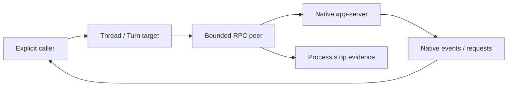

# Experimental Codex app-server transport

This is the first offline C07 slice, pinned against the locally generated
Codex CLI 0.163.0 wire schema recorded in `planning/C01_REVIEW.md`.
It is not yet connected to the production Runner or a public runtime API.
The legacy `codex exec` driver remains in place.

`Open` uses a trusted absolute executable and workspace with an explicit
environment, then sends `initialize` and `initialized`. It does not log in,
select a model, create a thread or start work. `Info` exposes native startup
facts; these do not establish authentication or capability availability.

`Call` correlates an explicit native method with its response. `Events` exposes
structured notifications and server requests. Numeric and string IDs remain
distinct. Callbacks belong to that connection and exact request, and can be
answered once. `Respond`/`Reject` return local `queued` receipts; JSON-RPC has no
generic acknowledgement that a question or approval reply was consumed.

Frames are limited to 256 KiB, pending calls to 32, events to 64 and native
request identity tombstones to 1024 per connection. Exhausted receive capacity
fails the transport and stops its supervised process, rather than silently
dropping a request or reporting success. RPC operations have a ten-second bound.
Timeout/disconnect after queue acceptance returns `ErrOutcomeUnknown`; there is
no automatic replay. `Close` retains actual process-tree stop evidence.

`OpenWithLifetime(hostLifetime, operation, config)` allows a host-owned Peer to
outlive a successfully completed initialization/RPC context. `Open` preserves
its original single-context behavior. Cancellation after RPC enqueue still
fails the Peer and returns unknown; separating lifetimes does not relax that
fence. The independent `internal/runtimecodex` package composes this protocol
with the experimental ledger; this package has no runtime/scheduling dependency.

The calling C02–C06 control layer still needs durable Task context/inputs,
explicit Run/instance selection, authorization, binding/turn generation checks,
event/effect persistence and request reconciliation. It must drain the adapter
independently of UI subscribers, redact private native parameters before public
display, and keep Turn completion separate from background-work stop evidence.
This transport does not implement those policies or a new inference/tool loop.
The eventual common API wraps protocol differences while retaining visible
instance/Run identity, progress, artifacts, requests and failures. It must not
hide capability asymmetry or expose unredacted native data as normal UI output.

The offline supervised fixture tests cover two turns on one connection,
resume without replay, steer/interrupt targets, native callback identity,
out-of-order replies, duplicate/conflicting input, disconnects, timeouts and
backpressure. Fixture success does not establish real harness or cross-platform
runtime compatibility. No ordinary test invokes a real model or account.

## Typed native control slice

`StartThread` and `ResumeThread` require an explicit model, approval policy and
sandbox mode. They use the trusted workspace, with symlinks canonicalized, and
return the native configuration separately. A known model/mode/workspace
mismatch returns `ErrConfiguration` with the observed native thread ID for
reconciliation; it starts no Turn and does not silently choose another model.
An otherwise valid but unexpected native thread ID is also retained in the
configuration observation before the connection is invalidated; no usable
Thread is returned for that mismatch.
This is a deliberately small subset of the pinned native options, not a public
runtime API or a claim that the selected mode enforces OS isolation.

The immutable connection-owned `Thread` supports `Read` and `StartText`;
the returned `Turn` targets `SteerText` and `Interrupt` at that exact native pair.
Resume/read do not submit input, a stale steer is not queued, and interrupt RPC
success is separate from `turn/completed`, background stop or process-tree stop.
Effort is forwarded explicitly; native acceptance is not proof of the model's
actual reasoning effort. Missing/malformed response identity terminates the
connection and reports an unknown outcome instead of returning a usable handle.

The diagram describes adapter control, not completed Task persistence or
authorization. The supervised test child validates wire fields and counts
operations; its hand-written, schema-informed frames are not native recordings.

## Native question and approval callbacks

`Turn.Request` binds a received callback to the immutable connection/thread/turn
target. Known user-input, command-approval and file-approval methods are handled
separately; experimental user-input handling requires explicit negotiation.
Question IDs, options, secret/other and blocking flags are preserved. Replies
must address the actual question set; concurrent answers can queue only once.
An approval forwards an offered decision unchanged in meaning. When a native
list is absent, the pinned schema's four basic decisions are explicitly labeled
`schema_default`, not advertised as discovered native options. Unknown methods,
unoffered decisions, null/duplicate policy fields and broader amendments fail.
Parameters and returned question/decision data are defensive copies, but still
contain private material requiring caller-owned presentation/redaction policy.

The transport invalidates a callback on `serverRequest/resolved` before publishing
the notification. Resolution is not approval, and numeric/string IDs remain
distinct. A resolved ID cannot be revived by a delayed callback. The authorized
application can call `Turn.InvalidateRequests` when ending/revoking execution;
this closes only its local answer channel, with at most 1024 target tombstones.
It does not send a decision, stop work or create a new Turn. `turn/completed`
alone does not invent request resolution or background-work stop evidence.

All response receipts remain local `queued`. Durable PendingRequest/CAS,
principal/authority checks, cross-restart reconciliation, event/outbox storage
and native-consumption evidence still belong to the unimplemented C02–C06
application boundary. This adapter is not exposed through the production Runner.
