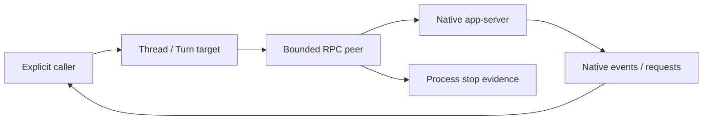

# Experimental Codex app-server transport

This is the first offline C07 slice, pinned against the locally generated
Codex CLI 0.163.0 wire schema recorded in `planning/C01_REVIEW.md`.
It is not yet connected to the production Runner or a public runtime API.
The legacy `codex exec` driver remains in place.

`Open` uses a trusted absolute executable and workspace with an explicit
environment, then sends `initialize` and `initialized`. It does not log in,
select a model, create a thread or start work. `Info` exposes native startup
facts; these do not establish authentication or capability availability.

`Call` correlates an explicit native method with its response. `Events` exposes
structured notifications and server requests. Numeric and string IDs remain
distinct. Callbacks belong to that connection and exact request, and can be
answered once. `Respond`/`Reject` return local `queued` receipts; JSON-RPC has no
generic acknowledgement that a question or approval reply was consumed.

Frames are limited to 256 KiB, pending calls to 32, events to 64 and native
request identity tombstones to 1024 per connection. Exhausted receive capacity
fails the transport and stops its supervised process, rather than silently
dropping a request or reporting success. RPC operations have a ten-second bound.
Timeout/disconnect after queue acceptance returns `ErrOutcomeUnknown`; there is
no automatic replay. `Close` retains actual process-tree stop evidence.

The calling C02–C06 control layer still needs durable Task context/inputs,
explicit Run/instance selection, authorization, binding/turn generation checks,
event/effect persistence and request reconciliation. It must drain the adapter
independently of UI subscribers, redact private native parameters before public
display, and keep Turn completion separate from background-work stop evidence.
This transport does not implement those policies or a new inference/tool loop.
The eventual common API wraps protocol differences while retaining visible
instance/Run identity, progress, artifacts, requests and failures. It must not
hide capability asymmetry or expose unredacted native data as normal UI output.

The offline supervised fixture tests cover two turns on one connection,
resume without replay, steer/interrupt targets, native callback identity,
out-of-order replies, duplicate/conflicting input, disconnects, timeouts and
backpressure. Fixture success does not establish real harness or cross-platform
runtime compatibility. No ordinary test invokes a real model or account.

## Typed native control slice

`StartThread` and `ResumeThread` require an explicit model, approval policy and
sandbox mode. They use the trusted workspace, with symlinks canonicalized, and
return the native configuration separately. A known model/mode/workspace
mismatch returns `ErrConfiguration` with the observed native thread ID for
reconciliation; it starts no Turn and does not silently choose another model.
This is a deliberately small subset of the pinned native options, not a public
runtime API or a claim that the selected mode enforces OS isolation.

The immutable connection-owned `Thread` supports `Read` and `StartText`;
the returned `Turn` targets `SteerText` and `Interrupt` at that exact native pair.
Resume/read do not submit input, a stale steer is not queued, and interrupt RPC
success is separate from `turn/completed`, background stop or process-tree stop.
Effort is forwarded explicitly; native acceptance is not proof of the model's
actual reasoning effort. Missing/malformed response identity terminates the
connection and reports an unknown outcome instead of returning a usable handle.

The diagram describes adapter control, not completed Task persistence or
authorization. The supervised test child validates wire fields and counts
operations; its hand-written, schema-informed frames are not native recordings.

## Fixed schema and supported control subset

The 2026-11-04 offline audit uses the official `rust-v0.163.0` tag at
[`83086188ae0614bd882818ff1aa23f3194962012`](https://github.com/openai/codex/tree/83086188ae0614bd882818ff1aa23f3194962012).
The request and response schemas below are the stable JSON schemas in
[`codex-rs/app-server-protocol/schema/json/v2`](https://github.com/openai/codex/tree/83086188ae0614bd882818ff1aa23f3194962012/codex-rs/app-server-protocol/schema/json/v2).
They establish wire shapes, not authenticated availability or model capability.

| Method / schema prefix | Native required request | Native required response | Typed client subset |
| --- | --- | --- | --- |
| `thread/start` / `ThreadStart` | None | `thread`, `model`, `modelProvider`, `cwd`, `approvalPolicy`, `approvalsReviewer`, `sandbox` | Explicit model, approval and sandbox, with the trusted workspace |
| `thread/read` / `ThreadRead` | `threadId` | `thread` | Bound ID and explicit `includeTurns`; returns the private raw Thread |
| `thread/resume` / `ThreadResume` | `threadId` | Same as start | Bound ID and the same explicit configuration; no input replay |
| `turn/start` / `TurnStart` | `threadId`, `input` | `turn` | One text input and explicit effort; returns ID and initial status |
| `turn/steer` / `TurnSteer` | `threadId`, `expectedTurnId`, `input` | `turnId` | One text input for the exact bound Turn; checks returned ID |
| `turn/interrupt` / `TurnInterrupt` | `threadId`, `turnId` | Object; `{}` is valid | Exact bound pair; RPC success alone does not attest stopping |

Each prefix names its `Params.json` and `Response.json`. Native thread creation
permits omitted configuration; this client requires an explicit selection. It
supports all nine combinations of `untrusted` / `on-request` / `never` and
`read-only` / `workspace-write` / `danger-full-access`. Granular approval objects,
reviewer/provider selection, custom configuration/instructions, service tiers,
ephemeral creation, resume history controls and pagination are not exposed by
these typed methods. No omitted option is claimed to have been disabled natively.

Native Turn input also supports images, audio, skills and mentions. The typed
client only sends text and does not expose other per-Turn configuration overrides,
text-element annotations, output schemas or caller message IDs. In this version
`text_elements` defaults to `[]`, so omission is valid; `ReasoningEffort` is a
nonempty string, not a fixed enum. The client additionally bounds IDs/model/effort
to 512 bytes without whitespace/control characters and requires nonempty text
of at most 128 KiB. Passing these checks does not prove a model supports an effort.
The raw `Peer.Call` escape hatch does not establish typed support for more options.

Start explicitly sends the experimental `allowProviderModelFallback: false`.
The pinned source defaults it to false and
[gates an experimental boolean only when true](https://github.com/openai/codex/blob/83086188ae0614bd882818ff1aa23f3194962012/codex-rs/codex-experimental-api-macros/src/lib.rs#L264);
this does not require experimental negotiation. Other experimental
options remain outside the typed subset. Unknown methods/options never trigger
an automatic fallback or retry.

Response validation checks the fields this client uses, not the entire native
schema. Start/resume do not expose `approvalsReviewer`, instruction sources,
disabled plugins, service tier or reported reasoning effort; resume cursors and
collaboration mode are also unconsumed. Thread history remains private raw data,
and StartText does not expose initial items/error/timing fields. Native `Turn`
requires `id/items/status`; its error may be absent, null or an object. Successful
typed fixtures include every required Thread field, including nullable
`projectId`, and exercise all four Turn statuses. Transport-only and deliberate
malformed fixtures remain minimal or invalid by design.

Offline regressions cover all supported configuration pairs, both `includeTurns`
values, native status/error shapes and configuration mismatch without starting
work, alongside the existing identity, stale-target and unknown-outcome tests.
These are owned synthetic child processes; they do not establish native history
hydration, real model/tool execution, authentication, permissions or OS isolation.

## Native question and approval callbacks

`Turn.Request` binds a received callback to the immutable connection/thread/turn
target. Known user-input, command-approval and file-approval methods are handled
separately; experimental user-input handling requires explicit negotiation.
Question IDs, options, secret/other and blocking flags are preserved. Replies
must address the actual question set; concurrent answers can queue only once.
An approval forwards an offered decision unchanged in meaning. When a native
list is absent, the pinned schema's four basic decisions are explicitly labeled
`schema_default`, not advertised as discovered native options. Unknown methods,
unoffered decisions, null/duplicate policy fields and broader amendments fail.
Parameters and returned question/decision data are defensive copies, but still
contain private material requiring caller-owned presentation/redaction policy.

The transport invalidates a callback on `serverRequest/resolved` before publishing
the notification. Resolution is not approval, and numeric/string IDs remain
distinct. A resolved ID cannot be revived by a delayed callback. The authorized
application can call `Turn.InvalidateRequests` when ending/revoking execution;
this closes only its local answer channel, with at most 1024 target tombstones.
It does not send a decision, stop work or create a new Turn. `turn/completed`
alone does not invent request resolution or background-work stop evidence.

All response receipts remain local `queued`. Durable PendingRequest/CAS,
principal/authority checks, cross-restart reconciliation, event/outbox storage
and native-consumption evidence still belong to the unimplemented C02–C06
application boundary. This adapter is not exposed through the production Runner.
