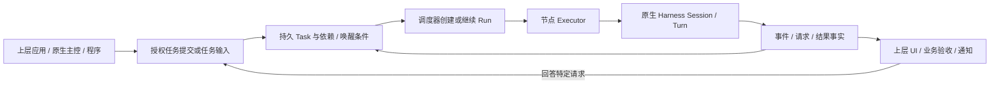

# 任务驱动与 DeepSeek 原型借鉴方案

日期：2026-11-02。需求基线：R2026-11-02.3；任务驱动由 R91 定义，任务与待处理边界由 R92 定义；本次只更新规划，不引入运行依赖。

## 决定：任务是工作生命周期的中心

任务持有目标/输入引用、授权、依赖、状态、结果引用和后续唤醒条件。
用户聊天、程序调用、授权的外部事件和已配置的定时触发都可以提交任务或补充既有任务。
聊天结束、单轮结束和会话释放均不自动结束任务；业务验收仍由上层决定。
持续会话是任务执行与交互的资源，不能反过来成为调度系统的唯一根实体。

这个调度循环只处理确定性状态与命令，不重新实现模型推理或工具调用循环。
若上层需要语义研判“是否应该接单”，可调用原生 harness 的主控任务生成建议，再由授权用例核验；
程序明确提交的任务不必先绕过一轮模型评估或创建用户聊天。

## 已审计的 DeepSeek 原型

来源由 Owner 明确为 [deepseek-ai/dsh-superagent-prototype](https://github.com/deepseek-ai/dsh-superagent-prototype)。
固定提交：`6337fc823ce20251c8de8085948165c81aaa701e`；package 版本 0.1.0。
本次通过 GitHub 读取文档与源码，未安装、运行、导入包或执行其 setup。
README 定位为研究原型、单 GitHub 仓库的 DSH 应用；发布版也不等同内部版本或文章中的所有设计。

| 编号 | 已读源码 / 文档 | 可采用的逻辑 | Coordica 的调整 |
| --- | --- | --- | --- |
| DS01 | [领域模型](https://github.com/deepseek-ai/dsh-superagent-prototype/blob/6337fc823ce20251c8de8085948165c81aaa701e/docs/001-domain.md)、`src/core/ports.ts` | Ticket 与 Assignment 生命周期分开，Executor 是领域外部端口 | 对应 Task 与 Run/执行绑定；保留多会话、多节点，不能固定一任务一 DSH 会话 |
| DS02 | [intake.ts](https://github.com/deepseek-ai/dsh-superagent-prototype/blob/6337fc823ce20251c8de8085948165c81aaa701e/src/core/intake.ts) | 不可变 Trigger、去重、将后续输入投递到现有工作 | 上层解析来源；底座接受带身份/来源/幂等键的 TaskInput，不内置飞书/GitHub 研判 |
| DS03 | [assignments.ts](https://github.com/deepseek-ai/dsh-superagent-prototype/blob/6337fc823ce20251c8de8085948165c81aaa701e/src/core/assignments.ts) | 区分输入待送、已送、会话读入及轮次结束；结构化 question 触发人工介入 | 只报告协议能证明的 consumed；未观测保持未知；问题/工具审批/授权继续分开 |
| DS04 | [effects.ts](https://github.com/deepseek-ai/dsh-superagent-prototype/blob/6337fc823ce20251c8de8085948165c81aaa701e/src/app/effects.ts)、`src/core/engine.ts` | 事务内记录效果，提交后执行；去重键、generation 和重试退避 | 扩展现有 outbox；运行启动和外部副作用不得一概重放；累计次数不因更新 payload 重置 |
| DS05 | [dsh.ts](https://github.com/deepseek-ai/dsh-superagent-prototype/blob/6337fc823ce20251c8de8085948165c81aaa701e/src/executor/dsh.ts)、`src/executor/background.ts` | 启动前预留槽；后台任务存在时不将轮次结束误判为空闲 | 分别记录调度槽、进程和原生后台工作；停止未知不能释放关键资源或重复派工 |
| DS06 | [执行文档](https://github.com/deepseek-ai/dsh-superagent-prototype/blob/6337fc823ce20251c8de8085948165c81aaa701e/docs/003-execution.md) | 为人的补充消息优先提供继续机会；等待与失败持久化 | 采用可配置的恢复优先级/预留容量，不默认越过节点硬容量增加额外槽 |
| DS07 | [runtime.ts](https://github.com/deepseek-ai/dsh-superagent-prototype/blob/6337fc823ce20251c8de8085948165c81aaa701e/src/app/runtime.ts)、[package.json](https://github.com/deepseek-ai/dsh-superagent-prototype/blob/6337fc823ce20251c8de8085948165c81aaa701e/package.json) | 组合根连接 Engine、Sources、Executor、Effects 与 Sessions | 仅借鉴职责边界；原实现依赖 Cordis 和 DSH 内部服务，不能作为跨 harness 公共运行层直接嵌入 |

阅读源文件不等于其测试已通过；本次没有验证 DSH 实际运行、跨平台或故障恢复保证。
仓库声明 MIT；本次只记录行为与结构。若以后复制代码，另核对固定版本 LICENSE、保留声明并记录第三方来源。

## 明确不直接照搬的语义

- 原型只有 Eval 接受后创建 Ticket；Coordica 也必须支持程序直接提交已授权任务，不能强制每个任务调用主控模型。
- 原型让订阅线程的消息成为上下文，并对部分人工后续消息恢复已结束 Ticket；Coordica 不把 human 标签当权限。
  上下文到达、继续执行和扩大范围分别判断；结束任务的重开需显式命令或事先授权的事件策略及当前授权复核。
- 原型部分策略变化通过输入通知正在工作的执行器；Coordica 的授权撤销和版本围栏必须由宿主强制执行。
- 原型在无跟随 PR 时可由 ready 报告完成 Ticket；Coordica 只接受相应执行事实，业务验收不由模型报告决定。
- 原型重启会通过恢复说明让执行器检查外部状态；Coordica 还必须有持久幂等和不确定副作用阻断，不能只靠提示词。
- 原型的 worker shell 权限、后台时限、人工交接释放槽位和额外人工槽是其部署策略，不作为底座通用默认值。
- GitHub/飞书 Source、业务接单 Policy、Channel 发言规则、PR 完成规则和单仓库目录模型留在上层应用。

## 对当前设计的具体补充

### TaskInput 与唤醒

TaskInput 记录 input_id、task_id、source_app、source_event_id、actor_ref、kind、内容引用、目标版本和授权上下文。
kind 至少区分 context、continuation、request_response；context 默认只追加材料，不自动启动工作。
来源事件去重键限定应用/来源/事件；一次事件是否可触发多个任务由显式策略决定，不能简单全局去重误吞合法扇出。
外部重复事件携带不同内容时保留冲突，不静默替换已经处理的输入。

唤醒产生独立 WakeIntent，引用 Task、事件/请求、策略版本和期待状态；重复唤醒只消费一次。
事务中核对 Task 当前状态、授权、依赖、取消、现行策略和版本；事务外调用原生端。
父子结果、人工回答、额度重置和程序命令走同一唤醒入口；UI 无须保持打开，也不需要持续用户对话。
外部来源认证、过滤、日历/cron 与业务研判由上层连接器处理；底座只提供有界输入与执行原语。

### 输入送达与会话资源

输入有 persisted、queued、delivered、consumed、delivery_unknown 等事实；consumed 仅在原生协议提供证据时记录。
更换 Run/会话后未读输入按 input_id 和交接记录重新投递；有未知外部影响的消息不能自动重发。
同一 Session 复用多个 Task 时必须串行绑定且保持权限/上下文域兼容；不同应用/授权域默认不得复用。
创建空 Session 可以用于配置或诊断，但任何产生工作的 Turn 都必须属于可审计 Task/Run。
会话 API 可显式请求创建独立会话任务；不能因为用户打开聊天就暗中创建无授权任务。

### 工作流边界

Task 记录基础执行状态；模型报告作为报告/结果证据，不是权限或业务终态。
底座提供依赖、子任务、等待、恢复和事件通知；审查后发布、群聊发言顺序和长期知识归档由上层编排。
原生主控是可选的受管 Agent，和程序提交同权同规则；底座不依赖主控始终在线才能调度明确任务。

## 规划落点与验收

| 现有任务 | 补充交付 | 验收 |
| --- | --- | --- |
| C02 | 先固定 Task 为中心的实体关系、TaskInput 和无需聊天的程序提交 | V02、V16 |
| C03/C05 | Session 为资源，输入作用到正确 Task/Run/Turn，送达与消费事实分开 | V03–V04、V16 |
| C04/C12 | 有界持久 WakeIntent、输入去重、未知副作用与重启对账 | V05、V09、V16 |
| C06 | 人工响应关联请求和任务；恢复不授予新权限 | V06、V16 |
| C11/C13 | 任务依赖、输入唤醒、调度归属、后台工作计量和可配置恢复优先级 | V08、V11、V16 |
| C15/C17 | 程序和非聊天客户端；外部来源只通过公共任务/输入契约接入 | V13–V14、V16 |

不新增一轮“完整移植 DeepSeek 框架”的任务，也不改变原先持续交互优先的实施顺序。
T3 主要参考多 harness 会话/交互机制；DeepSeek 原型主要参考任务/执行器/事件推进。
两者都不能替代 Coordica 自己的多节点权威、授权和恢复边界。
