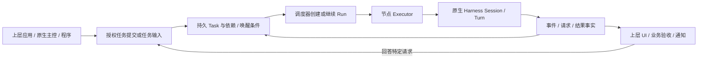

# 任务驱动与 DeepSeek 原型借鉴方案

日期：2026-11-02。当前需求基线：R2026-11-02.5；任务驱动由 R91 定义，边界由 R92–R101 补充；不引入外部框架运行依赖。

## 决定：任务是工作生命周期的中心

最新 R101：先做多 harness 聚合，协作、自驱动编排和跨 harness 接力后置。
本文件保留 DeepSeek 的机制研究，首期只采用保持 Task 上下文、输入送达、原生请求和安全幂等所需的最小部分。
不实现自主 Wake 派工、总管或每 Agent 自循环，也不为了以后编排提前建设未使用实体和通用框架。

首版先做调用方明确指定 harness/实例的执行与统一记录；逻辑 Thread 可记录不同 provider 的 Run，
但不把跨厂商接力或摘要交接当作第一条链路的前置。先由 Codex 最小纵向接入校验必要控制层，再用第二家验证。
复杂依赖/父子编排、主控选择策略和自动切换留待后续；程序明确提交不需要模型研判或 Chief。

任务持有目标/输入引用、授权、依赖、状态、结果引用和后续唤醒条件。
用户聊天、程序调用、授权的外部事件和已配置的定时触发都可以提交任务或补充既有任务。
聊天结束、单轮结束和会话释放均不自动结束任务；业务验收仍由上层决定。
持续会话是任务执行与交互的资源，不能反过来成为调度系统的唯一根实体。

这个调度循环只处理确定性状态与命令，不重新实现模型推理或工具调用循环。
若上层需要语义研判“是否应该接单”，可调用原生 harness 的主控任务生成建议，再由授权用例核验；
程序明确提交的任务不必先绕过一轮模型评估或创建用户聊天。

## 已审计的 DeepSeek 原型

来源由 Owner 明确为 [deepseek-ai/dsh-superagent-prototype](https://github.com/deepseek-ai/dsh-superagent-prototype)。
固定提交：`6337fc823ce20251c8de8085948165c81aaa701e`；package 版本 0.1.0。
本次通过 GitHub 读取文档与源码，未安装、运行、导入包或执行其 setup。
README 定位为研究原型、单 GitHub 仓库的 DSH 应用；发布版也不等同内部版本或文章中的所有设计。

| 编号 | 已读源码 / 文档 | 可采用的逻辑 | Coordica 的调整 |
| --- | --- | --- | --- |
| DS01 | [领域模型](https://github.com/deepseek-ai/dsh-superagent-prototype/blob/6337fc823ce20251c8de8085948165c81aaa701e/docs/001-domain.md)、`src/core/ports.ts` | Ticket 与 Assignment 生命周期分开，Executor 是领域外部端口 | 对应 Task 与 Run/执行绑定；保留多会话、多节点，不能固定一任务一 DSH 会话 |
| DS02 | [intake.ts](https://github.com/deepseek-ai/dsh-superagent-prototype/blob/6337fc823ce20251c8de8085948165c81aaa701e/src/core/intake.ts) | 不可变 Trigger、去重、将后续输入投递到现有工作 | 上层解析来源；底座接受带身份/来源/幂等键的 TaskInput，不内置飞书/GitHub 研判 |
| DS03 | [assignments.ts](https://github.com/deepseek-ai/dsh-superagent-prototype/blob/6337fc823ce20251c8de8085948165c81aaa701e/src/core/assignments.ts) | 区分输入待送、已送、会话读入及轮次结束；结构化 question 触发人工介入 | 只报告协议能证明的 consumed；未观测保持未知；问题/工具审批/授权继续分开 |
| DS04 | [effects.ts](https://github.com/deepseek-ai/dsh-superagent-prototype/blob/6337fc823ce20251c8de8085948165c81aaa701e/src/app/effects.ts)、`src/core/engine.ts` | 事务内记录效果，提交后执行；去重键、generation 和重试退避 | 扩展现有 outbox；运行启动和外部副作用不得一概重放；累计次数不因更新 payload 重置 |
| DS05 | [dsh.ts](https://github.com/deepseek-ai/dsh-superagent-prototype/blob/6337fc823ce20251c8de8085948165c81aaa701e/src/executor/dsh.ts)、`src/executor/background.ts` | 启动前预留槽；后台任务存在时不将轮次结束误判为空闲 | 分别记录调度槽、进程和原生后台工作；停止未知不能释放关键资源或重复派工 |
| DS06 | [执行文档](https://github.com/deepseek-ai/dsh-superagent-prototype/blob/6337fc823ce20251c8de8085948165c81aaa701e/docs/003-execution.md) | 为人的补充消息优先提供继续机会；等待与失败持久化 | 采用可配置的恢复优先级/预留容量，不默认越过节点硬容量增加额外槽 |
| DS07 | [runtime.ts](https://github.com/deepseek-ai/dsh-superagent-prototype/blob/6337fc823ce20251c8de8085948165c81aaa701e/src/app/runtime.ts)、[package.json](https://github.com/deepseek-ai/dsh-superagent-prototype/blob/6337fc823ce20251c8de8085948165c81aaa701e/package.json) | 组合根连接 Engine、Sources、Executor、Effects 与 Sessions | 仅借鉴职责边界；原实现依赖 Cordis 和 DSH 内部服务，不能作为跨 harness 公共运行层直接嵌入 |

阅读源文件不等于其测试已通过；本次没有验证 DSH 实际运行、跨平台或故障恢复保证。
仓库声明 MIT；本次只记录行为与结构。若以后复制代码，另核对固定版本 LICENSE、保留声明并记录第三方来源。

## 明确不直接照搬的语义

- 原型只有 Eval 接受后创建 Ticket；Coordica 也必须支持程序直接提交已授权任务，不能强制每个任务调用主控模型。
- 原型让订阅线程的消息成为上下文，并对部分人工后续消息恢复已结束 Ticket；Coordica 不把 human 标签当权限。
  上下文到达、继续执行和扩大范围分别判断；结束任务的重开需显式命令或事先授权的事件策略及当前授权复核。
- 原型部分策略变化通过输入通知正在工作的执行器；Coordica 的授权撤销和版本围栏必须由宿主强制执行。
- 原型在无跟随 PR 时可由 ready 报告完成 Ticket；Coordica 只接受相应执行事实，业务验收不由模型报告决定。
- 原型重启会通过恢复说明让执行器检查外部状态；Coordica 还必须有持久幂等和不确定副作用阻断，不能只靠提示词。
- 原型的 worker shell 权限、后台时限、人工交接释放槽位和额外人工槽是其部署策略，不作为底座通用默认值。
- GitHub/飞书 Source、业务接单 Policy、Channel 发言规则、PR 完成规则和单仓库目录模型留在上层应用。

## 对当前设计的具体补充

### TaskInput 与唤醒

本节的自主事件唤醒/父子结果策略为后续研究。首期只处理已明确请求的输入排队/投递和原生答复，
最小可靠命令意图不自动创建下一项工作；不要求先实现完整 WakeIntent 调度器。

TaskInput 记录 input_id、task_id、source_app、source_event_id、actor_ref、kind、内容引用、目标版本和授权上下文。
kind 至少区分 context、continuation、request_response；context 默认只追加材料，不自动启动工作。
来源事件去重键限定应用/来源/事件；一次事件是否可触发多个任务由显式策略决定，不能简单全局去重误吞合法扇出。
外部重复事件携带不同内容时保留冲突，不静默替换已经处理的输入。

唤醒产生独立 WakeIntent，引用 Task、事件/请求、策略版本和期待状态；重复唤醒只消费一次。
事务中核对 Task 当前状态、授权、依赖、取消、现行策略和版本；事务外调用原生端。
父子结果、人工回答、额度重置和程序命令走同一唤醒入口；UI 无须保持打开，也不需要持续用户对话。
外部来源认证、过滤、日历/cron 与业务研判由上层连接器处理；底座只提供有界输入与执行原语。

### 输入送达与会话资源

输入有 persisted、queued、delivered、consumed、delivery_unknown 等事实；consumed 仅在原生协议提供证据时记录。
更换 Run/会话后未读输入按 input_id 和交接记录重新投递；有未知外部影响的消息不能自动重发。
同一 Session 复用多个 Task 时必须串行绑定且保持权限/上下文域兼容；不同应用/授权域默认不得复用。
创建空 Session 可以用于配置或诊断，但任何产生工作的 Turn 都必须属于可审计 Task/Run。
会话 API 可显式请求创建独立会话任务；不能因为用户打开聊天就暗中创建无授权任务。

### 工作流边界

Task 记录基础执行状态；模型报告作为报告/结果证据，不是权限或业务终态。
底座提供依赖、子任务、等待、恢复和事件通知；审查后发布、群聊发言顺序和长期知识归档由上层编排。
原生主控是可选的受管 Agent，和程序提交同权同规则；底座不依赖主控始终在线才能调度明确任务。

## 规划落点与验收

| 现有任务 | 补充交付 | 验收 |
| --- | --- | --- |
| C02 | 先固定 Task 为中心的实体关系、TaskInput 和无需聊天的程序提交 | V02、V16 |
| C03/C05 | Session 为资源，输入作用到正确 Task/Run/Turn，送达与消费事实分开 | V03–V04、V16 |
| C04/C12 | 有界持久 WakeIntent、输入去重、未知副作用与重启对账 | V05、V09、V16 |
| C06 | 人工响应关联请求和任务；恢复不授予新权限 | V06、V16 |
| C11/C13 | 任务依赖、输入唤醒、调度归属、后台工作计量和可配置恢复优先级 | V08、V11、V16 |
| C15/C17 | 程序和非聊天客户端；外部来源只通过公共任务/输入契约接入 | V13–V14、V16 |

不新增一轮“完整移植 DeepSeek 框架”的任务，也不改变原先持续交互优先的实施顺序。
T3 主要参考多 harness 会话/交互机制；DeepSeek 原型主要参考任务/执行器/事件推进。
两者都不能替代 Coordica 自己的多节点权威、授权和恢复边界。

## DeepSeek 最小架构映射（R2026-11-02.4）

以下保留该版评估。R2026-11-02.5 已将其中协作/自驱动实现与验收后置；C02–C07 首期只取任务记录与可靠原生控制的必要子集。

Owner 明确希望实现其架构机制。本轮完整核读固定提交 `6337fc823ce20251c8de8085948165c81aaa701e` 的
[000 Philosophy](https://github.com/deepseek-ai/dsh-superagent-prototype/blob/6337fc823ce20251c8de8085948165c81aaa701e/docs/000-philosophy.md)、
[001 Domain](https://github.com/deepseek-ai/dsh-superagent-prototype/blob/6337fc823ce20251c8de8085948165c81aaa701e/docs/001-domain.md)、
[007 Architecture](https://github.com/deepseek-ai/dsh-superagent-prototype/blob/6337fc823ce20251c8de8085948165c81aaa701e/docs/007-architecture.md)。
复核实际 `core/ports.ts`、`intake.ts`、`assignments.ts`、`app/runtime.ts`、`effects.ts`，以及
`core/engine.ts` 的事务入口、`tickets.ts` 的 addInput/wake、`executor/dsh.ts` 的 launch/delivery/事件/恢复，
`executor/background.ts` 的后台静止与停止路径。没有安装、导入或运行原型；只采用机制，不复制源码。

| 机制与源码证据 | Coordica 当前事实 | 本批最小落点与离线验收 |
| --- | --- | --- |
| Ticket 生命周期独立于 Assignment/Executor；ports 分隔核心和外部执行 | 旧开发 Task/Run 已分开，但中立 TaskContext 与无 Git 程序路径缺失 | C02 以 Task 保存材料/决策/进度/产物引用；Run/Assignment 绑定显式实例，换入口/释放 Session 后材料仍可读；V16、V19 |
| Runtime 组合 Engine、Sources、Executor；前台路由与后台工作角色分开 | 现有 HTTP/CLI/MCP 共用 app 用例，Runner 执行旧开发工作；不是新底座完整链路 | C07 最小 Codex 原生端口先行；C02/C03 将入口和后台绑定到同一任务，不要求额外主控模型；V18–V19 |
| Intake 存不可变 Trigger，显式扇出；关联只补上下文，不自动路由 | WorkNote 仅 recorded_only；已有来源幂等和重放前鉴权可借 | C02 TaskInput 明确 target Task、来源/事件/摘要和权限；context 不启动，continuation 才产生 WakeIntent；重放/冲突/合法扇出；V16、V19 |
| Engine.atomic 单一状态写者；Effects 事务入队、提交后执行，generation 防旧结果覆盖 | Store.Update + audit/outbox 已有；旧 outbox 没有逐效果 claim/ACK | C04 针对真实纵向需要补效果身份/领取/未知结果，不做通用框架；回滚不启动、重复唤醒不重复派工；V05、V09、V19 |
| Assignments 区分 delivered/read/report；后台 jobs/subagents 活动独立于单轮 idle | 旧 process/spool 有停止证据，缺持久多轮输入/请求 | C03–C06/C07 按协议报告输入、Turn、后台工作和请求；原生未确认 consumed 则未知；答复/结束事件只唤醒正确 Run；V04、V06、V19 |

**自驱动的边界：** 一个 Task 同时只有一个调度负责人；多个明确 Assignment 可按容量并行，但不能争写同一 native Session。
输入、执行结果和审批答复进入同一 Task/Input/Wake/Run 路径；无事、等依赖、等审批或等额度时不空转。
前台可持续接收输入而后台工作继续，但接收事实不等于原生已消费，更不授予新的权限。
TaskContext 跟 Task 走，线程和 Session 仅引用材料；不搬迁隐藏推理或将相关线程自动关联为执行目标。

最先交付 C07 离线原生端口，其次 C02 的任务上下文/输入与最小绑定，随后按实际协议需要串接 C03–C06。
此映射细化既有 C 任务，没有新增另一套状态机或批次；C09–C12 仍只准备。
后续可另行评估完整 Source 订阅、语义接单与复杂编排，本批不引入 DSH worker 工具、Feishu/GitHub 应用逻辑、
Cordis 运行依赖、原型的额外人工容量槽、策略变化仅发提示或自动重开任务等部署选择。
原型的 effect payload 更新会重置 attempts，不能照搬成可绕过 Coordica 累计重试的路径。
所有原生推理、工具和上下文管理仍由所选 harness 完成；显式指定 harness 与上述事件机制相容。

### 显式协作与后置编排

指定执行目标的粒度是每次 Run/Assignment，不把整个 Task 固定为单 Agent。
R2026-11-02.4 曾建议的协作程序契约是：按 Task/context 版本提交显式 Run、读取 TaskContext、记录绑定 Run/代际的结果与产物，
以及将明确输入投递给该执行；首版复用 Run 作为 Assignment，不另建同义生命周期。
多个执行者可在独立 Session/工作区按容量并行，控制层仍唯一负责 Task 状态和 TaskContext 版本写入。
调用方可以等待结果再提交下一步，或同时提交无依赖工作；上下文关联本身不会自动选人或派发。
自动拆任务、复杂依赖图、自动汇总评判、竞赛投票和无限递归仍不纳入本批。
这些协作接口尚未实现，现按 R101 后置；TaskContext 与单次显式执行的记录仍保留在首期。
不能把历史注册工具、旧开发调度或本次文档当作已支持声明。
